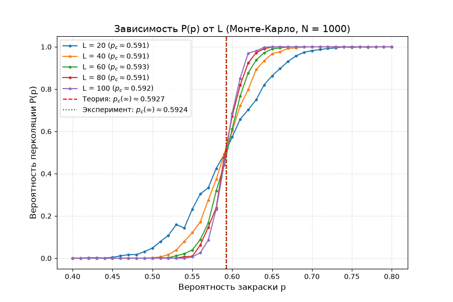

# 2D Site Percolation Visualization and Finite-Size Scaling Analysis

Исследовательский комплекс для моделирования узловой перколяции на квадратной решётке $L \times L$ с использованием алгоритма **Хошена-Копельмана (Hoshen-Kopelman)** и метода **Монте-Карло**.

## 📌 Основные результаты

1. **Экспериментальный порог перколяции**: $p_c(\infty) = 0.5921 \pm 0.0011$ (теоретическое значение $p_c \approx 0.5927$, относительная погрешность **0.10%**).
2. **Подтверждение критического индекса**: Подтверждён теоретический критический индекс корреляционной длины $\nu = 4/3 \approx 1.333$ для двухмерной систем с помощью метода Коллапса Данных (Data Collapse).

---

## 📸 Визуализация и Графики

### 1. Интерактивная визуализация и детекция кластеров
Алгоритм Хошена-Копельмана разметит кластеры уникальными цветами, а сквозной перколяционный кластер выделяется ярко-красным цветом.


### 2. Масштабирование систем конечного размера (Finite-Size Scaling)
Зависимость вероятности перколяции $P(p)$ от вероятности закраски $p$ для решёток $L \in [20, 40, 60, 80, 100]$ ($N = 1000$ симуляций Монте-Карло).



### 3. Коллапс Данных (Data Collapse)
Приведение всех 5 кривых к единой универсальной макро-функции с помощью масштабированной переменной $x = (p - p_c) L^{1/\nu}$ при $\nu = 4/3$.


---

## 🛠 Архитектура проекта

```text
percolation-visualization/
├── data/                  # Кэш результатов симуляций в CSV
├── images/                # Графики и визуализации для документации
└── src/
    ├── percolation.py     # Модуль алгоритма Хошена-Копельмана и DSU
    ├── visualize.py       # Интерактивное окно с ползунком p
    ├── calculate.py       # Параллельные расчёты Монте-Карло и экстраполяция
    └── data_collapse.py   # Построение графика Коллапса Данных
